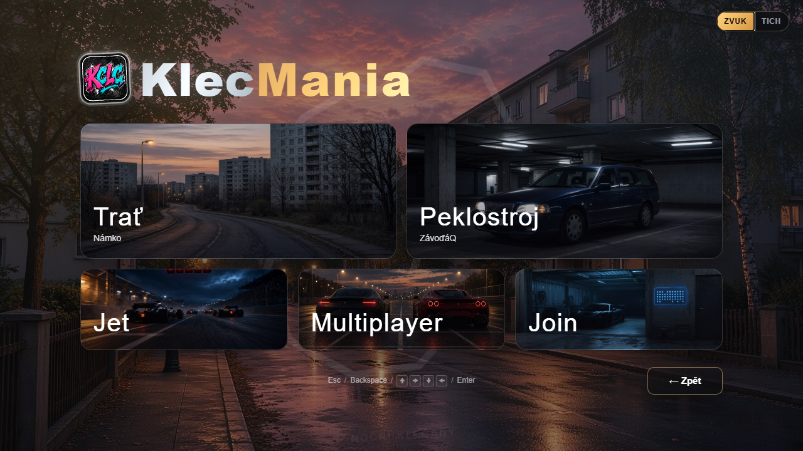

# KlecMania · v0.8



**Prohlížečová 2.5D semi-sim závodní hra** ze světa Klecan a okolí. Solo s AI, freestyle triky, online až 4 hráči.

Studentský produkt s vlastní značkou, tratěmi podle reálných míst, pečlivým menu a AI, která **kalibruje tempo z dojetých závodů**.

| | |
|--|--|
| **Hrát (Pages 0.8)** | https://gittizen.github.io/vertex-gp/0.8/ |
| **Hrát (Netlify 0.7)** | https://klecmania.netlify.app/ *(zatím bez 0.8)* |
| **Historie verzí** | https://gittizen.github.io/vertex-gp/ *(0.8 → 0.1)* |
| **Archivy** | [0.8](https://gittizen.github.io/vertex-gp/0.8/) · [0.7](https://gittizen.github.io/vertex-gp/0.7/) · [0.6](https://gittizen.github.io/vertex-gp/0.6/) · [0.5](https://gittizen.github.io/vertex-gp/0.5/) · [0.4](https://gittizen.github.io/vertex-gp/0.4/) · [0.3](https://gittizen.github.io/vertex-gp/0.3/) · [0.2](https://gittizen.github.io/vertex-gp/0.2/) · [0.1](https://gittizen.github.io/vertex-gp/0.1/) |
| **Příběh verzí** | [VERSIONS.md](./VERSIONS.md) — hub od nejnovější; text od 0.1 nahoru |
| **Changelog** | [CHANGELOG.md](./CHANGELOG.md) |
| **Rebuild prompt** | [RECREATE_PROMPT.md](./RECREATE_PROMPT.md) |

Autor: **Filip Khunt** · ve hře věkové omezení **16+** · repozitář historicky `vertex-gp`

---

## Co projekt ukazuje

| Oblast | Konkrétně |
|--------|-----------|
| **Produkt** | Entry → home → race setup → Jet/Multi/Join; atmosféry menu; hratelné archivy verzí |
| **UI / UX** | Dvoustupňové menu závodu, mobilní navigace zpět, schémata řízení, CS + EN |
| **3D / engine** | Tratě z dat (křivka → silnice + terén), stíny, výkonnostní režimy |
| **AI** | Soupeři ve stejné kategorii vozidla; live kalibrace cílových časů z dat závodů |
| **Síť** | Vlastní WebSocket lobby (max 4 hráčů) |
| **Proces** | Changelog, version hub, opakované herní testování a opravy |

---

## Hra stručně

- **Tratě** podle Klecan a okolí (Námko, Noční Klecany, Do Klecánek, Novostavby…) + freestyle Plácek  
- **Vozidla** od formule po skate; tuning s rozpočtem bodů  
- **AI** — Lehká / Střední / Těžká; default *každý solo závod jiní soupeři*  
- **Online** — Multi založí místnost, Join prohlíží / připojuje  
- **Menu** — Závod setup (Trať · Peklostroj · Jet/Multi/Join), hráčské vs pokročilé nastavení  
- **Žebříček** — Moje / Svět; nesmrtelné běhy s 👻

**Drobnosti pro hráče:** koloběžka v garáži (easter egg), soutěže, watermark tratí, CS + EN.

---

## AI a data

Po závodě hra umí zaznamenat tempo a použít ho při kalibraci soupeřů. AI tak míří na **reálnější časy tratě**, ne jen na pevný násobič rychlosti. Solo zároveň defaultně losuje jiné typy vozidel AI (stejná kategorie jako hráč).

---

## Technické výzvy (výběr)

1. Terén na okruhu vs paralelní asfalt (overlap / „falešná voda“)  
2. Čitelnost nočního města  
3. FPS a měření výkonu ve scéně  
4. Feel AI startu vs fér cílové časy; chování motorky  
5. Ovládání a navigace na telefonu  
6. Verze jako produkt (Netlify produkce + Pages archivy)

Jak verze rostly (0.1 → 0.8) a co se u každé řešilo: **[VERSIONS.md](./VERSIONS.md)** · **[CHANGELOG.md](./CHANGELOG.md)**

---

## Lokální běh

```bash
npm install
npm run dev:all
```

Jen klient: `npm run dev` → http://127.0.0.1:5173/

```bash
npm run build
npm run build:pages    # → site/ (hub + archivy)
```
