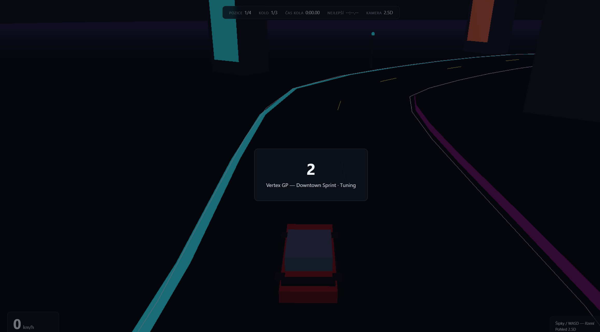

# 0.1 — Vertex GP (základ)

Dříve označeno jako **0.4**.

## Hrát
https://gittizen.github.io/vertex-gp/0.1/

## Patří sem
- Vite + TypeScript + Three.js
- Tratě jako data (`TrackDefs`) + mesh generátor
- AI Lehká / Střední / Těžká
- Solo + online WS (max 4)
- Tuning rozpočet + barvy

## Screenshot

## Git
- větev / ref: `0.1` → commit `6f21368` (*Launch Vertex GP…*)
