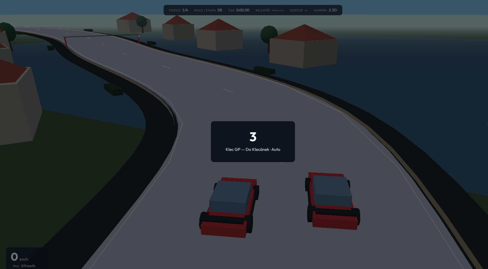

# 0.2 — Klec GP *(identita)*

Dříve označeno jako **1.0**. Oproti 0.1: značka, freestyle, online hub.

## Hrát
https://gittizen.github.io/vertex-gp/0.2/

## Co se změnilo oproti 0.1
- Rebrand **Klec GP** (logo, intro, watermark)  
- Freestyle / skate / Plácek + triky  
- Atmosféry menu; online hub (presence, rooms, Ready, laps)  
- Víc tratí a lokálního lore  

**Řešilo se:** oddělit závod od freestyle skóre; lobby bez dedicated serveru.

Celý příběh verzí: [../../VERSIONS.md](../../VERSIONS.md)

## Screenshot

## Git
- větev / ref: `0.2` → commit `54d764a` (*Release Klec GP 1.0…*)
