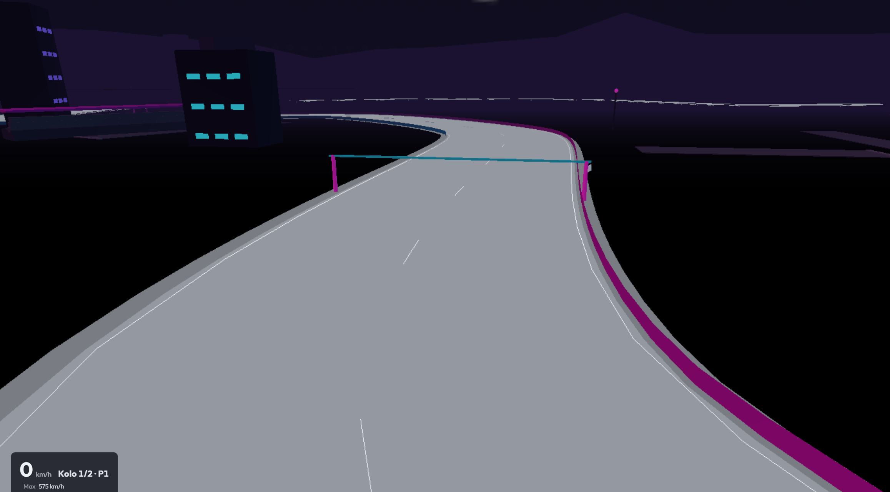

# 0.3 — mobil, hosting, polish

Dříve **1.1** + polish. Oproti 0.2: telefon, Netlify, první AI data.

## Hrát
https://gittizen.github.io/vertex-gp/0.3/

## Co se změnilo oproti 0.2
- Dotyk: volant, stick, náklon, ťukání  
- Netlify produkce + Pages archivy; `base: /`  
- Community / pace learning po dojetí; šampionát  
- Serpentiny a další obsah; vozidlo → tuning; Esc/restart polish  
- Přečíslování historie na 0.1 / 0.2 / 0.3  

**Řešilo se:** touch vs klávesnice, správný hosting base, první „AI z jízd“.

Celý příběh verzí: [../../VERSIONS.md](../../VERSIONS.md)

## Screenshot

## Git
- větev / ref: `0.3`
