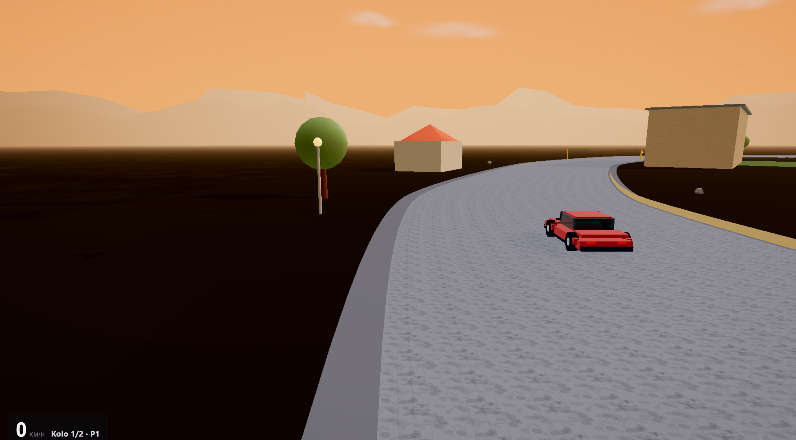

# 0.4 — reálnější svět

Oproti 0.3: okolí, terén, stíny — mapy už nejsou „auto nad deskou“.

## Hrát
https://gittizen.github.io/vertex-gp/0.4/

## Co se změnilo oproti 0.3
- Berm / apron / blanket, usazené budovy, hustší roadside  
- Unikátní podklady map (Námko, noc, rally…)  
- Stíny bez mizícího asfaltu; contact stín pod autem  
- Hub verzí se screenshoty; Netlify + Pages jako standard  

**Řešilo se:** fog „jezera“, z-fight, blanket přes asfalt, FPS u velkého groundu.

Celý příběh verzí: [../../VERSIONS.md](../../VERSIONS.md)

## Screenshot

## Git
- větev / ref: `0.4` · tag `v0.4.0`
