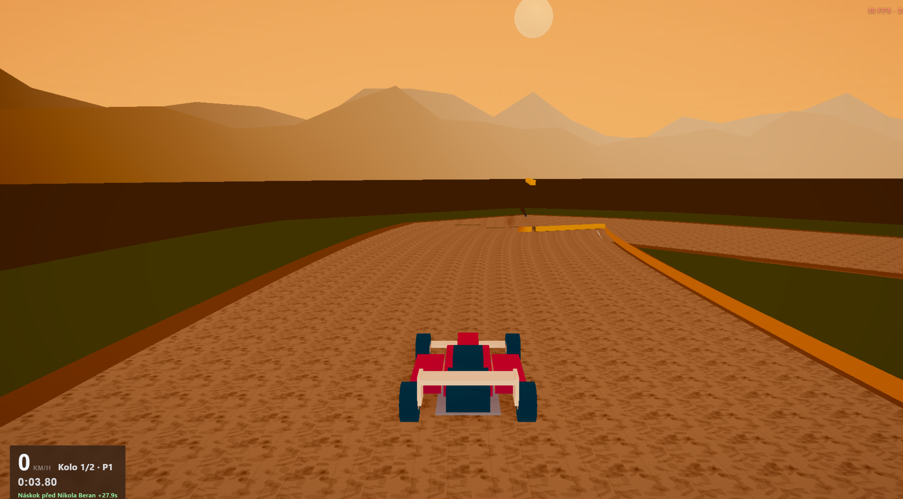

# 0.5 — AI tempo, atmosféra, demo polish

Oproti 0.4: živější AI z dat, menu jako produkt, lidské docs.

## Hrát
https://gittizen.github.io/vertex-gp/0.5/

## Co se změnilo oproti 0.4
- Live kalibrace AI tempa z dojetých závodů  
- Default: každý solo závod jiní AI soupeři  
- Kalendář atmosféry; Volvo V70 na Klecanech; HouseKit  
- Opravy terénu / noci; koloběžka easter egg  
- README, CHANGELOG, recreate prompt  

**Řešilo se:** feel startu AI vs fér časy; blanket na Námku; čitelná dokumentace.

Celý příběh verzí: [../../VERSIONS.md](../../VERSIONS.md)

## Screenshot

## Git
- větev / ref: `0.5` · tag `v0.5.0`
