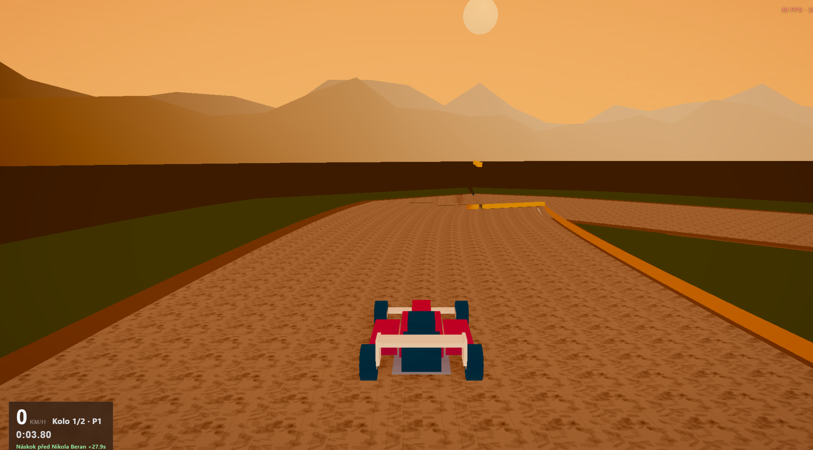

# 0.6 — UX menu, zvuk, landscape *(současná)*

Aktuální produkční větev Klec GP.

## Hrát
- GitHub Pages: https://gittizen.github.io/vertex-gp/0.6/
- Netlify (produkce): https://klecgp.netlify.app/

## Patří sem
- Domů: CTA **Jet** (1 klik do klasiky), chipy trať / vůz / obtíž
- Nastavení: Hráčské vs Pokročilé; dock Zpět ve všech panelech
- Engine zvuky podle peklostroje; freestyle tišejší; landscape-first
- UI `v0.6` / `package.json` `0.6.0`

## Screenshot

## Git
- větev / ref: `master` (aktuální)
- tag: `v0.6.0`
